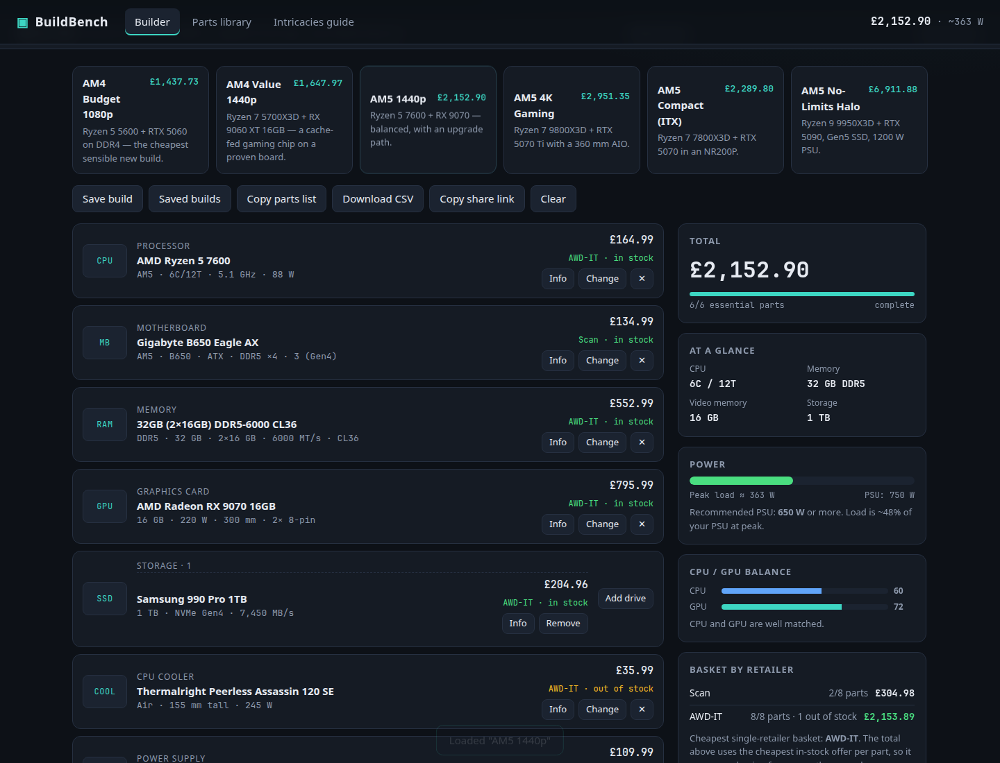
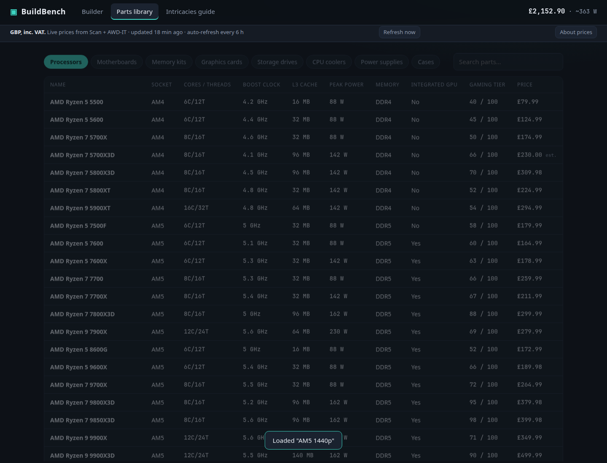
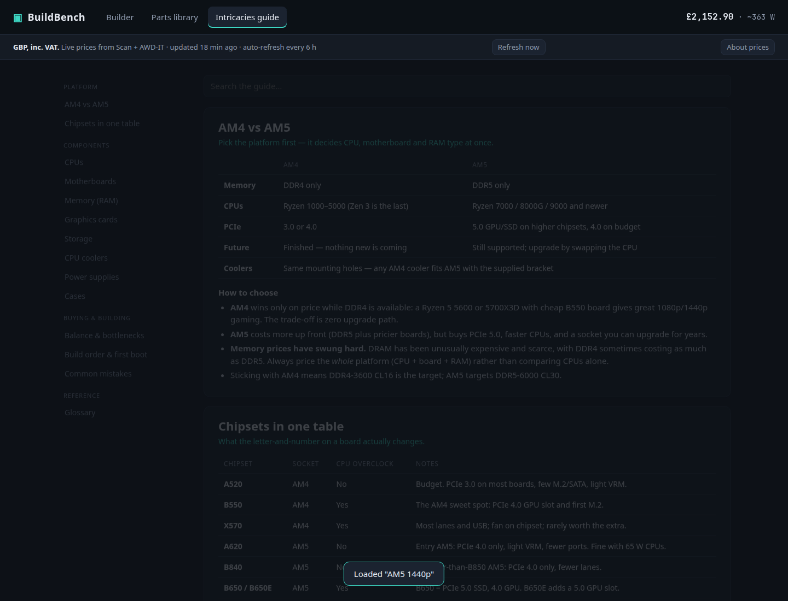

# BuildBench 🖥️

A PC building playground: pick parts, compare AMD AM4 and AM5 builds, see prices in British pounds, and learn what the specs actually mean.

**This app was generated with AI, guided by everyday language.** It started with a simple idea: “make an app about PC building, parts lists and their individual intricacies.” Follow-up prompts shaped it into a UK-focused planner. You can do the same with your own interests and preferences.

You don't need to understand all the code to start exploring. Try the app, decide what would make it more useful to you, and ask an AI coding assistant for one small change at a time.

## Take a look

Choose a starter build and swap parts while the total and compatibility advice update.



Browse the parts library to compare components and read their details.



The intricacies guide explains the trade-offs behind the numbers, from CPU cache to memory and cooling.



*Screenshots show a saved moment in time. Prices and availability will change.*

## Try it — no coding needed

1. On this GitHub page, click the green **Code** button, then **Download ZIP**.
2. Extract/unzip the downloaded folder. Keep all its files together.
3. Open **index.html** in your web browser (usually a double-click).
4. Click a starter build at the top, then try changing a part. Explore **Parts library** and **Intricacies guide** too.

This is the easiest way to explore: it uses the included price snapshot. Automatic retailer checks need the optional server below. Your saved builds stay in that browser on that device; there is no account or cloud backup.

This repository shares the project files. It is not a hosted website. A share link pointing to `localhost` or a file on your computer won't open the app on a friend's device; send them this GitHub page or export the parts list instead.

## Make it yours with AI

An AI coding assistant is a tool you can describe changes to in ordinary language. Use one that can open and edit a project folder, or import your own copy of this repository into one. If you want your own GitHub copy, use **Fork** at the top of this page. A fork is your own version, where you can experiment independently.

Start with this:

> I'm new to coding. Open this BuildBench project, explain how to run it in simple steps, and help me make one small change at a time. Explain any commands before asking me to run them.

Then try a prompt that describes your goal:

> I want a quieter gaming PC. Add a beginner-friendly explanation of what makes a build quiet, and show it beside the builder. Keep the AM4/AM5 focus and GBP prices.

> Give the app a blue colour theme and make the text a little larger. Keep all the existing buttons working, and show me the result.

> Add a field where I can enter my budget in pounds. Show how much is left as I choose parts, and highlight when I go over. Check it with both an empty build and a completed build.

> Rewrite the RAM explanation for someone building their first PC. Explain DDR4 versus DDR5, capacity, speed and latency with one short example each.

A useful prompt says **what you want, why it helps, and what should keep working**. Follow up with what you notice: “That text is too technical,” or “Can the budget sit beside the total?” You don't need to get the first prompt perfect.

Before a change, keep a copy of the folder or ask the assistant to save a Git checkpoint (a restore point). After a change, open the app and try the affected buttons. Ask the assistant to check its work and explain what it tested. AI can make mistakes; small changes are easier to understand and undo. Some assistants need an account or paid plan.

## Prices: what to expect

- All displayed money is in **GBP (£)**. Retailer prices are intended to include VAT; delivery costs can be extra.
- **AWD-IT and Scan** have automatic listing readers. With the server running, it checks whether a refresh is needed every ten minutes, with a default refresh interval of six hours. The open app checks the server for updates every five minutes.
- A retailer can refuse requests. The updater backs off for hours and keeps previously saved information. Scan has already blocked requests during development, so its feed may be paused.
- **Amazon UK, Overclockers UK and WaterCoolingUK** have retailer search links, rather than automatic price feeds in this version.
- Some figures are last-seen prices or labelled estimates. Product matching can pick the wrong variant. Always check the exact product, current price, stock and specifications on the retailer/manufacturer pages before buying.

The app is a learning and planning tool. The included snapshot is not a promise of today's prices, and the compatibility checks don't cover every possible hardware issue.

## Optional: run automatic price checks

The quick-start above needs only a browser. For the price updater, install **Node.js 20 or newer** if it isn't already on your computer. Then open a terminal in the extracted project folder. A terminal is an app where you type commands; an AI assistant can walk you through opening it on your system.

Run:

```sh
npm start
```

Leave that terminal open and visit **http://127.0.0.1:8080** in your browser. Press **Ctrl+C** in the terminal to stop it. There are no extra npm packages to install.

For a one-off price refresh:

```sh
npm run prices
```

If port 8080 is already being used, ask your assistant to help set the `PORT` environment variable. `HOST` and `REFRESH_HOURS` also configure the server. Retailer access and parsing can change; review the sites' current terms before operating a regular price tracker.

## A small map of the project

You can ask an AI assistant to handle these files for you:

| File | What it does |
| --- | --- |
| `index.html` | The page structure |
| `style.css` | Colours, spacing and layout |
| `app.js` | Buttons, screens, saved builds and exports |
| `data.js` | Parts catalogue and starter builds |
| `guide.js` | Component explanations and glossary |
| `logic.js` | Compatibility and power calculations |
| `server.js` | Runs the local app and scheduled price checks |
| `prices/` | Retailer readers and price matching |
| `prices.json` / `prices.js` | The included price snapshot |

For manually checked prices, the updater also accepts `prices/manual.json`. Ask your assistant to create an entry using a real product link, checked price and availability. Never put passwords, private information or API keys into files you publish on GitHub.

Built with HTML, CSS, JavaScript and a small Node.js server, with AI assistance and human direction. If you have an idea for making it more useful, that idea is a good first prompt.
